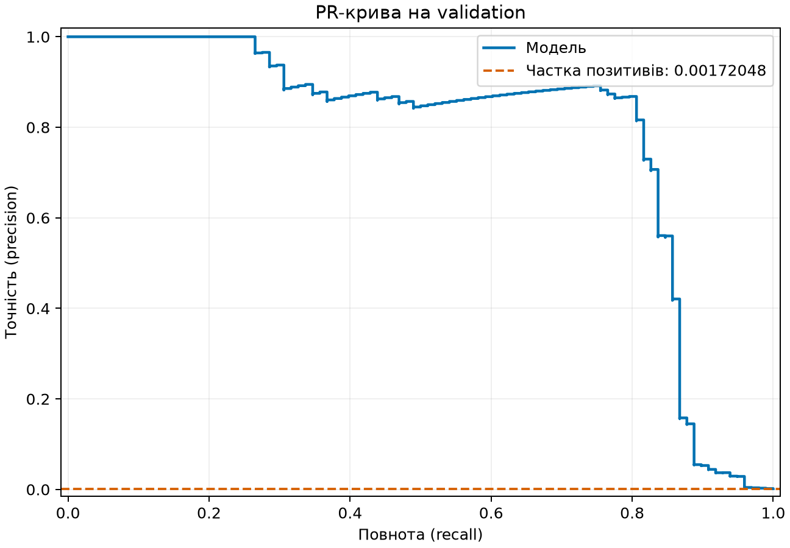
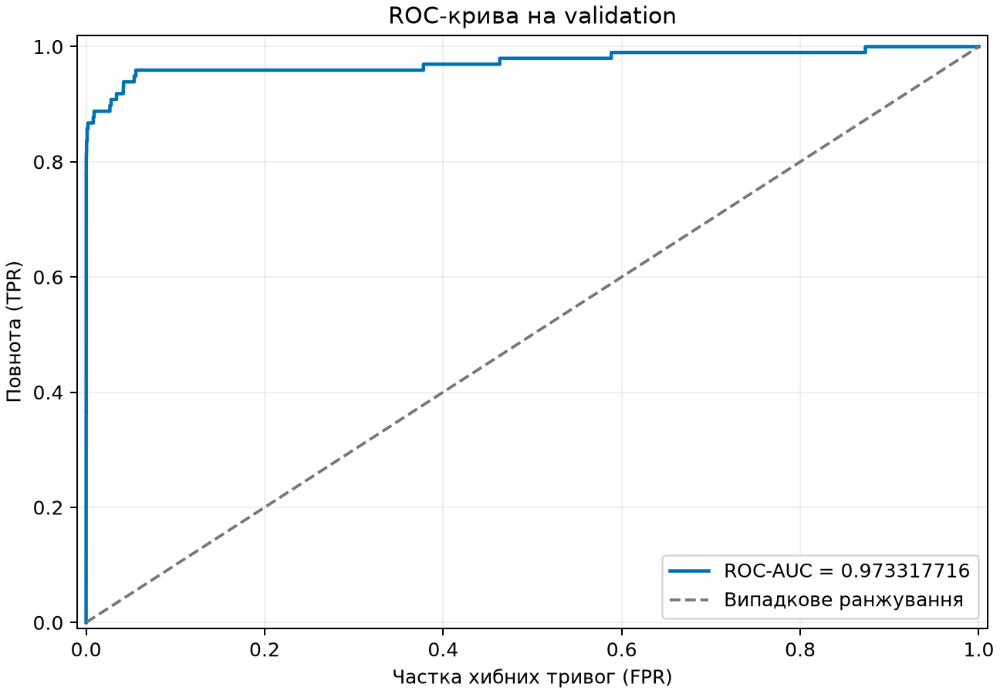

# ЛР2. Поріг рішення під асиметричну ціну помилок

## 1. Опис і відтворення

Мета роботи — вибрати поріг рішення для незмінної моделі за мінімумом вартості C = 10·FN + FP на validation та оцінити зафіксований поріг на test.

- **Набір даних:** [Credit Card Fraud Detection на Kaggle](https://www.kaggle.com/datasets/mlg-ulb/creditcardfraud). Файл `creditcard.csv` завантажується окремо та зберігається локально; до репозиторію його не додають. Для завантаження з Kaggle потрібен обліковий запис.

- **Робоча тека:** перед виконанням команд перейдіть із кореня репозиторію в каталог лабораторної роботи:

  ```bash
  cd lab2
  ```

- **Підготовка середовища:** потрібен Python 3.12. Залежності зафіксовано у `pyproject.toml` і `uv.lock`, додатковий експорт — у `requirements.txt`. Встановіть їх командою:

  ```bash
  uv sync
  ```

  Навчання моделі виконується на CPU у float32.

- **Аналіз зі збережених прогнозів без навчання:** 

  ```bash
  uv run python lab2_analysis.py --saved results
  ```


- **Навчання моделі з локального CSV:** передайте шлях до `creditcard.csv` і нову або порожню теку для результатів:

  ```bash
  uv run python lab2_starter.py --data /шлях/до/creditcard.csv --out results
  ```

  Замість `/шлях/до/creditcard.csv` вкажіть фактичний шлях до локального датасету. Навчання виконує всі 12 епох і зберігає ваги та прогнози. Стартовий скрипт забороняє запис у непорожню теку результатів. Для окремої перевірки відтворюваності зі збереженням наданих результатів укажіть `--out new_results`; для аналізу цього нового запуску використайте `--saved new_results`.

*Примітка: аналіз також можна запустити з кореня репозиторію, указавши робочу теку проєкту:*

```bash
uv run --directory lab2 python lab2_analysis.py --saved results
```

## 2. Поділ і підготовка даних

| Вибірка | n | Позитивів | Частка позитивів |
| --- | --- | --- | --- |
| train | 170884 | 295 | 0.00172631727 |
| validation | 56961 | 98 | 0.00172047541 |
| test | 56962 | 99 | 0.00173800077 |

Разом: 284807 рядків, 492 позитивів. Джерело: [`split_summary.csv`](results/split_summary.csv). Індекси покривають усі рядки без повторення та перетину вибірок.

Два стратифіковані поділи індексів: спершу 60% train і 40% відкладено, потім відкладена частина навпіл на validation/test; обидва `random_state=0`. Використано V1–V28 та Amount, без Time і Class. StandardScaler навчено лише на train. Статистики на всіх даних спричинили б витік інформації з validation/test і оптимістично зміщену оцінку. Масиви ознак для моделі та прогнози float32; сире Amount і статистики scaler збережено у вихідній точності стартового коду. Лічильники цілочисельні.

Налаштування незмінні: Linear(29,32) → ReLU → Linear(32,1); BCEWithLogitsLoss без вагів класів; Adam lr=1e-3; 12 епох, batch=1024, SEED=0. Окремий `np.random.default_rng(0)` перемішує train на кожній епосі. Параметри, архітектуру й епоху не підбирали. MPS не використано. Метадані запуску: [`run.json`](results/run.json).

## 3. Правило й метрики

Оцінка s = sigmoid(z). Прогноз 1, якщо **s ≥ t**, інакше 0.

- TP: фактичний клас 1, прогноз 1.
- FP: фактичний клас 0, прогноз 1 (хибна тривога).
- FN: фактичний клас 1, прогноз 0 (пропущене шахрайство).
- TN: фактичний клас 0, прогноз 0.

**C = 10·FN + FP**, precision = TP/(TP+FP), recall = TP/(TP+FN). Amount у вартість не входить. У власній реалізації `confusion` та метриках sklearn не використано. Якщо TP+FP=0, позитивних прогнозів немає і precision не визначена. Якщо TP+FN=0, позитивних об'єктів немає і recall не визначений. Код повертає None; у CSV це порожня клітинка, у Markdown «не визначена». Нуль не підставляється.

## 4. Пошук порога

Кандидати: всі унікальні оцінки validation плюс +inf. Оцінки сортуються за спаданням; кумулятивні суми позитивів і негативів дають TP/FP. Для кожної групи рівних оцінок береться **останній елемент**, щоб рівні оцінки мали однаковий прогноз. FN=P−TP, TN=N−FP.

Для +inf: TP=FP=0, FN=P, TN=N (усі негативні). Мінімальна оцінка дає всіх позитивних. Перший мінімум C серед кандидатів у спадному порядку має найбільший поріг і розв'язує нічию. Складність O(n log n), додаткова пам'ять O(n); циклу за порогами у швидкому пошуку немає.

Повна таблиця: [`threshold_candidates.csv`](results/threshold_candidates.csv). Зафіксований t* = **0.031193923205137253**, без округлення, у [`threshold.json`](results/threshold.json). +inf у JSON серіалізується рядком `"inf"` з `allow_nan=False`. Test не бере участі у виборі порога.

## 5. Validation

ROC-AUC = **0.97331771637308**, обчислено через sklearn. Значення також збережено у [`analysis_summary.json`](results/analysis_summary.json).

| Правило | Поріг | TP | FP | FN | TN | C |
| --- | --- | --- | --- | --- | --- | --- |
| стандартний поріг 0.5 | 0.5 | 71 | 9 | 27 | 56854 | 279 |
| мінімум вартості t* | 0.0311939232 | 82 | 34 | 16 | 56829 | 194 |
| усі негативні (+inf) | +inf | 0 | 0 | 98 | 56863 | 980 |

Джерело: [`validation_rules.csv`](results/validation_rules.csv).



PR-крива містить базову лінію частки позитивів validation.



Висока ROC-AUC характеризує ранжування за всіма порогами й не гарантує малої C чи високої precision при конкретному порозі. ROC не залежить від вибраного робочого порога; при сильному дисбалансі навіть малий FPR дає багато FP порівняно з TP. AUC не враховує асиметричну ціну помилок 10:1.

## 6. Незалежні перевірки A/B/C

`brute_force` окремо створює унікальні кандидати плюс +inf і для кожного прямо застосовує s ≥ t до всіх об'єктів. Він не викликає функції швидкого алгоритму чи власні функції метрик і не використовує їхні результати. Порівняно точно всі кандидати, TP/FP/FN/TN/C та обраний поріг. Помилка спричиняє `SystemExit` з назвою набору і причиною до будь-якої оцінки test.

| Набір | n | t* | C | Збіг |
| --- | --- | --- | --- | --- |
| A | 6 | 0.400000006 | 2 | ТОЧНИЙ |
| B | 3 | +inf | 0 | ТОЧНИЙ |
| C | 13 | 0.800000012 | 10 | ТОЧНИЙ |

A перевіряє дві оцінки 0.7 з різними мітками. B перевіряє відсутність позитивів: recall не визначений за кожного порога; при +inf також не визначена precision. C перевіряє два мінімуми з однаковою C і вибір більшого порога. Всі ручні оцінки з умови збігаються з результатами. Десяткові 0.4 і 0.8 у float32 мають невелику похибку представлення, а правило нічиєї та цілочисельні вартості лишаються точними.

Набір C візуально звірено з таблицею й приміткою на сторінці 2 `ЛР2 завдання.pdf`: s=[0.8]+[0.5]×11+[0.2], y=[1,1]+[0]×10+[0], разом 13 елементів. Це підтверджена інтерпретація PDF.

### Набір A

| threshold | TP | FP | FN | TN | C |
| --- | --- | --- | --- | --- | --- |
| +inf | 0 | 0 | 2 | 4 | 20 |
| 0.899999976 | 0 | 1 | 2 | 3 | 21 |
| 0.699999988 | 1 | 2 | 1 | 2 | 12 |
| 0.400000006 | 2 | 2 | 0 | 2 | 2 |
| 0.200000003 | 2 | 3 | 0 | 1 | 3 |
| 0.100000001 | 2 | 4 | 0 | 0 | 4 |

### Набір B

| threshold | TP | FP | FN | TN | C |
| --- | --- | --- | --- | --- | --- |
| +inf | 0 | 0 | 0 | 3 | 0 |
| 0.899999976 | 0 | 1 | 0 | 2 | 1 |
| 0.600000024 | 0 | 2 | 0 | 1 | 2 |
| 0.300000012 | 0 | 3 | 0 | 0 | 3 |

### Набір C

| threshold | TP | FP | FN | TN | C |
| --- | --- | --- | --- | --- | --- |
| +inf | 0 | 0 | 2 | 11 | 20 |
| 0.800000012 | 1 | 0 | 1 | 11 | 10 |
| 0.5 | 2 | 10 | 0 | 1 | 10 |
| 0.200000003 | 2 | 11 | 0 | 0 | 11 |

Повні швидкі й повільні таблиці та порівняння: [`sanity_checks.md`](results/sanity_checks.md), окремо `sanity_*_fast.csv`, `sanity_*_brute.csv`.

## 7. Test за зафіксованим порогом

Поріг прочитано **лише з threshold.json**, після всіх успішних перевірок. На test його не переобирали. Матриця плутанини при t*:

| Фактичний клас | Прогноз 1 | Прогноз 0 |
| --- | --- | --- |
| 1 | 80 | 19 |
| 0 | 43 | 56820 |

При t*: C=233, precision=0.650406504, recall=0.808080808.

| Правило | Поріг | TP | FP | FN | TN | C | precision | recall |
| --- | --- | --- | --- | --- | --- | --- | --- | --- |
| стандартний поріг 0.5 | 0.5 | 71 | 8 | 28 | 56855 | 288 | 0.898734177 | 0.717171717 |
| мінімум вартості t* | 0.0311939232 | 80 | 43 | 19 | 56820 | 233 | 0.650406504 | 0.808080808 |
| усі негативні (+inf) | +inf | 0 | 0 | 99 | 56863 | 990 | не визначена | 0 |

Пороги 0.5 і +inf наведено для довідки; вони не змінюють t*. Precision при +inf не визначена, бо немає позитивних прогнозів. Джерело: [`test_rules.csv`](results/test_rules.csv).

## 8. Приклади помилок

Перші п'ять FP та перші п'ять FN окремо відсортовано за `test_row_ids` за зростанням. Нумерація рядків CSV від 0 без заголовка. Якщо помилок типу менше п'яти, наведено всі. Amount сире, із `test_amount`; відстань = |s−t*|.

| Рядок CSV (від 0) | Тип | Мітка | Оцінка | Amount | Відстань до t* |
| --- | --- | --- | --- | --- | --- |
| 460 | FP | 0 | 0.196158603 | 2 | 0.164964676 |
| 2961 | FP | 0 | 0.0809607953 | 2.49 | 0.0497668721 |
| 10783 | FP | 0 | 0.966327071 | 89.99 | 0.935133159 |
| 13405 | FP | 0 | 0.932031631 | 89.99 | 0.900837719 |
| 13617 | FP | 0 | 0.922762096 | 89.99 | 0.891568184 |
| 10497 | FN | 1 | 0.0114643537 | 3.79 | 0.0197295696 |
| 52521 | FN | 1 | 0.00637312327 | 105.99 | 0.0248208009 |
| 55401 | FN | 1 | 0.00564156333 | 1 | 0.0255523603 |
| 91671 | FN | 1 | 0.000500423659 | 290.18 | 0.0306934994 |
| 93486 | FN | 1 | 0.0183515213 | 0 | 0.0128424019 |

| Тип | n | Amount середнє | Amount медіана | Відстань середня | Відстань медіана |
| --- | --- | --- | --- | --- | --- |
| FP | 5 | 54.892 | 89.99 | 0.588454122 | 0.891568184 |
| FN | 5 | 80.192 | 3.79 | 0.0227277264 | 0.0248208009 |

Для наведених FP середнє Amount = 54.892, медіана = 89.99; для FN відповідно 80.192 і 3.79. Середня відстань до порога: FP 0.588454122, FN 0.0227277264; медіана: FP 0.891568184, FN 0.0248208009. У цих прикладах середнє Amount вище для FN, а середня відстань до порога більша для FP.

За цими прикладами не можна судити про причини помилок: вибірка мала, нерепрезентативна, відібрана за номером рядка, а не випадково. Порівняння описове й не доводить причинного впливу Amount або близькості оцінки до порога. Джерела: [`error_examples.csv`](results/error_examples.csv) і [`error_summary.csv`](results/error_summary.csv).

## 9. Висновок

Поріг змінив лише рішення за тими самими збереженими оцінками незмінної моделі. Ціна переходу від 0.5 до t*:

| Вибірка | FN уникнуто (0.5 → t*) | Додаткові FP (0.5 → t*) | Зменшення C (0.5 → t*) |
| --- | --- | --- | --- |
| validation | 11 | 25 | 85 |
| test | 9 | 35 | 55 |

Вартість залежить від обміну FP і FN: одна уникнута FN компенсує до десяти додаткових FP. Числові зміни збережено у [`decision_changes.csv`](results/decision_changes.csv).

Виграш на validation не гарантований на test: поріг підігнано під validation, позитивів мало (validation: 98, test: 99), є шум вибірки, а C(t) ступінчаста. Одна зміна рішення щодо позитивного об'єкта змінює C на 10. Test використано для остаточного вимірювання, без зміни порога чи налаштувань.

## 10. Використані інструменти

Роботу виконано з допомогою генеративного інтелекту **ChatGpt**.
