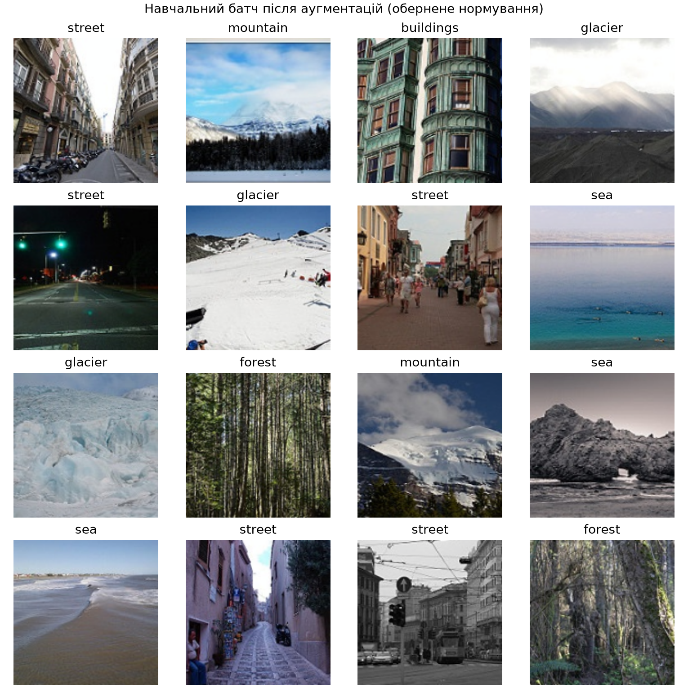
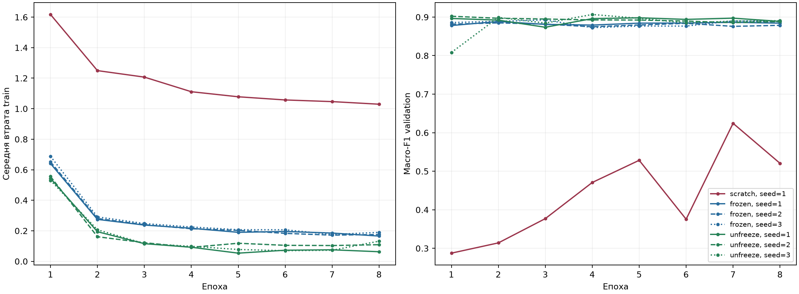
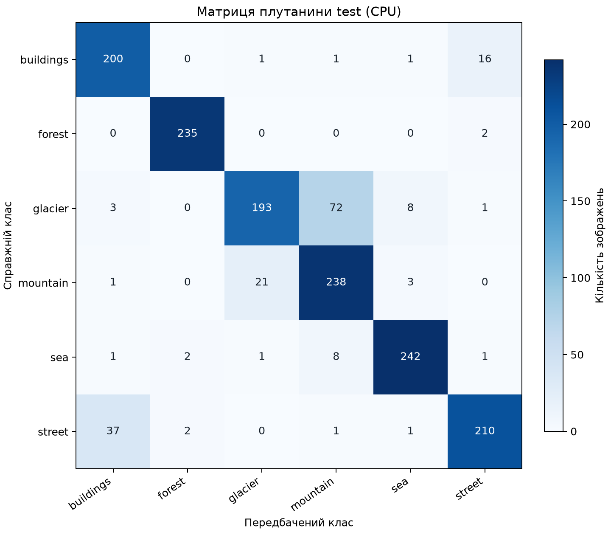
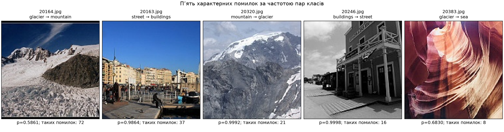

# ЛР3. Обчислювальний експеримент і трансферне навчання


## Відтворення та середовище

Команди виконуються з теки `lab3/`. У `--data-root` викладач підставляє власний шлях до локального набору — теки із `seg_train/` і `seg_test/`. Нижче наведено шлях на машині автора. Залежності встановлюються автоматично через uv.

**1. Повне навчання нового експерименту.** Перевірка поділу та пунктів 1–2, рівно сім запусків, збереження журналів і логітів validation, вибір за validation та збереження моделі. Test не використовується. Усі нові артефакти записуються в окрему теку `lab3/reproduced/`.

```bash
uv run python train.py --data-root /Users/tokarievihor/Desktop/deepl/lab3/intel_image --output-dir reproduced
```

Теку `reproduced/` не включено до репозиторію, тому після клонування команда виконає всі перевірки та сім навчань заново. Наявні опубліковані `runs/`, `checks/`, `figures/`, `split.csv` і `lab3_model.pt` залишаються в початковій теці. Якщо обрана тека вже містить навчальні результати, команда повідомить про це до запису поділу й перевірок: для іншого експерименту вкажіть іншу теку, для продовження поточного — скористайтеся командою 3.

**2. Аналіз експерименту.** Перевірка хешів поділу й вибору моделі; таблиця запусків, криві та ефекти; оцінка test на CPU, матриця плутанини та п’ять помилок. Команда читає й записує артефакти тієї самої теки, яку вказано при навчанні.

```bash
uv run python analyze.py --data-root /Users/tokarievihor/Desktop/deepl/lab3/intel_image --output-dir reproduced
```

Для відтворення саме опублікованих чисел цього README у команді 2 замініть значення `reproduced` на `.`: тоді аналіз використає початкові журнали й модель, без нового навчання. Для аналізу нового навчання залиште `reproduced`; його macro-F1 може відрізнятися від таблиць звіту. Програма завжди використовує явно вибрану теку й не перемикається між експериментами автоматично.

**3. Продовження перерваного експерименту (`resume`).** Тека має бути тією самою, що в команді 1. Завершені запуски пропускаються лише за наявності журналу, логітів і ваг та правильних хешів. Незавершений запуск виконується заново. Перевірки пунктів 1–2 пропускаються лише за відповідного звіту зі статусом OK.

```bash
uv run python train.py --data-root /Users/tokarievihor/Desktop/deepl/lab3/intel_image --output-dir reproduced --resume
```

Відносне значення `--output-dir` рахується від розташування скриптів, а не від поточної робочої теки; абсолютний шлях також підтримується. Без цього параметра використовується початкова тека `lab3/`. Запис результатів усередину теки датасету заборонено. Для першого повного експерименту викладач виконує команди 1 і 2, команда 3 потрібна лише після переривання.

Параметр окремої теки результатів додано після початкового експерименту. Функції чисельного навчання, побудова моделей, поділ, гіперпараметри та ваги збережених семи запусків не змінювалися. Історичні `source_sha256` у журналах збережено: вони описують версію, якою отримано таблиці цього звіту. Нові експерименти отримують хеш поточної версії; resume перевіряє збіг коду в межах одного експерименту.

Використано **Apple M5, MPS, float32**; тест — CPU float32. Python 3.12.14; платформа `macOS-26.6.2-arm64-arm-64bit`. Прямі залежності зафіксовано через `==`, повне дерево залежностей — у [uv.lock](uv.lock).

| Бібліотека | Версія |
|---|---|
| torch | 2.14.1 |
| torchvision | 0.29.1 |
| numpy | 2.5.4 |
| scikit-learn | 1.9.1 |
| matplotlib | 3.11.2 |
| pillow | 12.3.0 |

Навчання на MPS/GPU може бути недетермінованим і залежить від версій бібліотек, тому повторне навчання може дати інші macro-F1. Збережений CPU-аналіз відтворює числа цього звіту; гіперпараметри після тестової оцінки не змінювалися. Відхилень від фіксованих налаштувань експерименту немає.

## 1. Перевірки до навчання

Використано `seg_train/seg_train` і `seg_test/seg_test`; `seg_pred` не читається. Облік вихідного набору підтвердив 14 034 навчальні та 3 000 контрольні JPEG, разом 17 034, з яких 55 мають розмір, відмінний від 150×150. Їх не відкидали. Файли відкриваються через `Image.open(...).convert("RGB")`; набір не копіювався й не змінювався. Хеш вмісту всіх вихідних JPEG до й після роботи збігся, див. [checks/execution_audit.json](checks/execution_audit.json).

Для кожного класу імена відсортовано як рядки; один `default_rng(0)` послідовно обирає по 200 train, інший незалежний `default_rng(0)` ділить кожен клас `seg_test` навпіл. Усі завантажувачі надалі читають лише [split.csv](split.csv), зберігаючи його порядок для validation/test. `train_test_split` не використовується.

| Клас | train: кількість / сума | validation | test | Збіг |
|---|---:|---:|---:|---|
| buildings | 200 / 1996761 | 218 / 4837323 | 219 / 4837559 | так |
| forest | 200 / 2032625 | 237 / 5276962 | 237 / 5291326 | так |
| glacier | 200 / 2183923 | 276 / 6135652 | 277 / 6157250 | так |
| mountain | 200 / 1950345 | 262 / 5789535 | 263 / 5849765 | так |
| sea | 200 / 1987613 | 255 / 5655068 | 255 / 5668011 | так |
| street | 200 / 1841817 | 250 / 5541845 | 251 / 5547533 | так |
| Разом | 1200 / 11993084 | 1498 / 33236385 | 1502 / 33351444 | так |

Усі 18 клітинок збіглися. Повторів імен файлів немає: жоден файл не входить одночасно до train, validation і test.



Показано обернено нормовані тензори, які отримує модель, з мітками. Train: `RandomResizedCrop(160, scale=(0.7,1.0)) → RandomHorizontalFlip() → ToTensor() → Normalize`; validation/test: `Resize((160,160)) → ToTensor() → Normalize`. В усіх режимах mean=(0.485,0.456,0.406), std=(0.229,0.224,0.225); інші аргументи стандартні й явно записані в `run.json`.

Початкова втрата на першому train-батчі, нові моделі seed=1, після `set_train_mode`, без кроку оптимізатора:

| Режим | L₀ | ln 6 | Відхилення |
|---|---:|---:|---:|
| scratch | 2.047884464 | 1.791759469 | +0.256124995 |
| frozen | 1.924394369 | 1.791759469 | +0.132634900 |

`ln 6 ≈ 1.792` — втрата лише для рівномірних імовірностей. Випадкова лінійна голова дає нерівні логіти; їхній масштаб, ознаки та склад конкретного батча змінюють L₀. Тому збіг із ln 6 не очікується. У scratch прямий прохід під `no_grad()` усе одно оновлює BN-буфери; ці два екземпляри після перевірки відкинуто.

## 2. Перевірка режимів

| Режим | Усього | Навчаються | Групи: numel / lr | Збіг |
|---|---:|---:|---|---|
| scratch | 11179590 | 11179590 | усі: 11179590 / 0.003 | так |
| frozen | 11179590 | 3078 | fc: 3078 / 0.003 | так |
| unfreeze | 11179590 | 8396806 | fc: 3078 / 0.003; layer4: 8393728 / 0.0003 | так |

Заморожених параметрів в оптимізаторі немає.

### Зміни після п’яти кроків

| Режим | Модуль | Параметри змінилися | Статистики BN змінилися | Збіг |
|---|---|---|---|---|
| frozen | conv1 | ні | немає BN | так |
| frozen | bn1 | ні | ні | так |
| frozen | layer1 | ні | ні | так |
| frozen | layer2 | ні | ні | так |
| frozen | layer3 | ні | ні | так |
| frozen | layer4 | ні | ні | так |
| frozen | fc | так | немає BN | так |
| unfreeze | conv1 | ні | немає BN | так |
| unfreeze | bn1 | ні | ні | так |
| unfreeze | layer1 | ні | ні | так |
| unfreeze | layer2 | ні | ні | так |
| unfreeze | layer3 | ні | ні | так |
| unfreeze | layer4 | так | так | так |
| unfreeze | fc | так | немає BN | так |


### Навмисна помилка model.train()

Прогноз до запуску: параметри замороженого кістяка не зміняться, але його ковзні статистики BN змінюватимуться: це буфери, на які requires_grad не впливає. На кривій втрати train цю помилку, ймовірно, не буде помітно.

| Режим | Модуль | Параметри змінилися | Статистики BN змінилися | Збіг |
|---|---|---|---|---|
| frozen | conv1 | ні | немає BN | так |
| frozen | bn1 | ні | так | так |
| frozen | layer1 | ні | так | так |
| frozen | layer2 | ні | так | так |
| frozen | layer3 | ні | так | так |
| frozen | layer4 | ні | так | так |
| frozen | fc | так | немає BN | так |

max |Δ running_mean| у layer1.0.bn1 = 0.092836380.

max |Δ running_var| у layer1.0.bn1 = 0.120314360.

Прогноз зміни параметрів і буферів підтверджено. П’ять кроків підтверджують зміну буферів; помітність на повній кривій не вимірювалася.

requires_grad=False керує обчисленням градієнтів параметрів; running_mean, running_var та num_batches_tracked є буферами й оновлюються у forward за training=True. У unfreeze layer4 навчається, тому оновлення його BN-статистик відповідає протоколу.

У `set_train_mode` спочатку викликається `model.train()`, потім `eval()` для conv1, bn1, layer1–layer4 у frozen та conv1, bn1, layer1–layer3 у unfreeze. Функцію викликають на початку кожної епохи. У scratch усе залишається в train. В unfreeze layer4 адаптує ознаки під нову задачу, тому його BN має оцінювати статистики поточних активацій.

Порівняння `torch.equal` охопило повний `state_dict`: параметри, running_mean, running_var та num_batches_tracked. Кожна перевірка використовувала новий екземпляр seed=1 і перші п’ять батчів, без validation і без збереження моделі. Прогноз навмисної помилки був у константі `BN_PREDICTION` й записаний у [checks/intentional_bn_prediction.txt](checks/intentional_bn_prediction.txt) до її запуску. Усі перевірки збіглися; [повний звіт](checks/checks_report.md), [машинний звіт](checks/checks_report.json).

## 3. Сім запусків

Один scratch seed=1, три frozen seed=1,2,3 і три unfreeze seed=1,2,3. Для кожного — 8 епох × 38 кроків = 304; batch_size=32, останній батч 16, validation batch_size=64. Train перемішується глобальним генератором PyTorch, без окремого generator/sampler і без повторного засівання між побудовою моделі й навчанням. `num_workers=0`, `drop_last=False`.

AdamW: weight_decay=1e-4, betas=(0.9,0.999), eps=1e-8, інші стандартні аргументи та фактичний склад груп записано в кожному `run.json`. CrossEntropyLoss — середня за батчем, втрата епохи = Σ L_b·|b| / 1200, де L_b обчислено до кроку оптимізатора. Після кожної епохи — eval, no_grad і macro-F1 на validation. Не використовувалися розклади lr, clipping, mixed precision, smoothing, ваги класів, рання зупинка чи вибір епохи.

| # | Режим | Зерно | Втрата train, еп. 8 | macro-F1 val, еп. 8 | Час навчання, с |
|---|---|---:|---:|---:|---:|
| 1 | scratch | 1 | 1.029304334 | 0.520520294 | 49.618 |
| 2 | frozen | 1 | 0.165452499 | 0.884201244 | 24.759 |
| 3 | frozen | 2 | 0.175655503 | 0.878500329 | 24.390 |
| 4 | frozen | 3 | 0.189583163 | 0.888595570 | 24.528 |
| 5 | unfreeze | 1 | 0.062740963 | 0.888832309 | 28.680 |
| 6 | unfreeze | 2 | 0.108879792 | 0.888424004 | 28.360 |
| 7 | unfreeze | 3 | 0.132129055 | 0.890579270 | 28.991 |

Час виміряно із синхронізацією пристрою навколо циклу навчання: включено train і validation усіх епох, не включено побудову моделі, завантаження ImageNet і запис артефактів. Орієнтири виконано: frozen близько 0.88, scratch нижче й суттєво вище 1/6. Ніяких додаткових запусків у таблиці немає.



Кожен `runs/<режим>_seed<зерно>/` містить `run.json`, `val_logits.npy` розміру 1498×6 і локальний `weights.pt`. Журнали містять усі налаштування, версії, пристрій, історію епох, час, хеш поділу, хеш коду та метадані git. Логіти мають порядок validation у split.csv; analyze.py повторно обчислює з них macro-F1 й перевіряє збіг із журналом. Ваги кожного запуску — після восьмої епохи, навіть якщо попередня validation була кращою.

## 4. Розклад ефектів

Для r ∈ {frozen, unfreeze}:

$$
\bar F_r=\frac{1}{3}\sum_{s=1}^{3}F_{r,s},\qquad R_r=\max_sF_{r,s}-\min_sF_{r,s},\qquad R=\max(R_{frozen},R_{unfreeze}).
$$

$$
\Delta_{pre}=\bar F_{frozen}-F_{scratch,1},\quad
\Delta_{unf}=\bar F_{unfreeze}-\bar F_{frozen},\quad
\Delta_{pre}+\Delta_{unf}=\bar F_{unfreeze}-F_{scratch,1}.
$$

| Величина | Значення |
|---|---:|
| F_scratch_1 | 0.520520294455 |
| F_mean_frozen | 0.883765714183 |
| R_frozen | 0.010095240174 |
| F_mean_unfreeze | 0.889278527966 |
| R_unfreeze | 0.002155266071 |
| R | 0.010095240174 |
| delta_pre | 0.363245419728 |
| delta_unf | 0.005512813783 |
| sum | 0.368758233511 |

- **delta_pre: ефект вартий перевірки, але не доведений.**
- **delta_unf: не відрізняється від розкиду, результату немає.**

Правило застосовано окремо до кожного ефекту: |Δ| ≤ R — «не відрізняється від розкиду, результату немає»; |Δ| > R — «ефект вартий перевірки, але не доведений». Розмах трьох значень — груба й нестійка оцінка шуму, не довірчий інтервал і не доказ значущості.

**Що змінює зерно.** У scratch воно змінює випадкову ініціалізацію всієї мережі та нової fc, порядок батчів і випадкові crop/flip. У frozen кістяк завантажується з однакових ImageNet-ваг, а зерно змінює fc, перемішування й аугментації; заморожені BN не адаптуються. У unfreeze початкові ваги кістяка також однакові, проте варіації fc, батчів та аугментацій додатково змінюють градієнти layer4 і його BN-буфери. Тому розкид frozen і unfreeze може відрізнятися: навчаються різні кількості параметрів, з різними швидкостями, і лише в unfreeze адаптуються глибокі BN-статистики.

**Межа висновку про scratch.** R отримано тільки з попередньо навчених режимів (запуски 2–7) і не оцінює розкид навчання з нуля: для scratch є лише seed=1. Його val macro-F1 змінився з 0.287448693 на першій епосі до 0.520520294 на восьмій; train loss — з 1.617149382 до 1.029304334. Крива validation коливається, тоді як train loss знижується; мережа навчається й не перебуває на рівні вгадування. За заданим правилом висновок щодо Δ_pre залишається «ефект вартий перевірки, але не доведений», але він умовний щодо одного scratch і цього бюджету: розкид scratch не виміряно, а з довшим навчанням відставання могло б скоротитися.

**Бюджет.** Кількість кроків однакова, час — різний. Середні виміряні тривалості: scratch 49.618 с, frozen 24.559 с, unfreeze 28.677 с. Frozen потребує лише прямого проходу кістяка й градієнтів голови; unfreeze додає backward layer4, scratch — backward усієї мережі. Отже, рівність 304 кроків не означає рівності часу.

## 5. Вибір і тест

За середнім validation вибрано режим **unfreeze** (середнє 0.889278527966), а в ньому — **unfreeze_seed3**, із найбільшим macro-F1 після восьмої епохи, 0.890579270447. У [lab3_model.pt](lab3_model.pt) збережено словник `state_dict`, `regime`, `seed`, `classes`, `img_size=160`. Аналіз перевіряє метадані та правило вибору за журналами, потім порівнює логіти validation основної моделі на CPU зі збереженими логітами вибраного запуску. Фіксовані допуски `rtol=0.0001`, `atol=0.0001` враховують числові відмінності MPS і CPU; передбачені класи мають збігтися для всіх зображень. При розбіжності код зупиняється до завантаження test. Це перевірка відповідності поведінки моделі, а не доказ побітової рівності її ваг.

У фактичній перевірці max |Δ логітів| = 6.29425049e-05; збіг передбачень — 1498/1498. Для аналізу після клонування потрібні `lab3_model.pt`, `split.csv`, код і сім комплектів `run.json` + `val_logits.npy`; локальні gitignored `runs/*/weights.pt` не читаються й не потрібні. Це перевірено повним запуском analyze.py у тимчасовій копії файлів для здачі без жодного `weights.pt`; метрики й хеш тестових логітів збіглися з попередніми результатами.

Додатково пройдено регресійні перевірки: шість перевірок захисту та один повний запуск без локальних ваг.

Перевірки нового інтерфейсу команд описані в [tests/test_teacher_commands.py](tests/test_teacher_commands.py); журнал виконання — [checks/teacher_workflow_tests.txt](checks/teacher_workflow_tests.txt). У тесті маршрутизації дорогу функцію навчання замінено тестовою функцією, що працює з копіями еталонних артефактів у тимчасовій теці. Команда аналізу запускається повністю на CPU. Ці перевірки не створюють нових експериментальних результатів і не входять до таблиці семи запусків.

Повний тест потребує локального набору `intel_image/`; без нього пропускається лише інтеграційна перевірка. Журнал: [checks/analysis_portability_tests.txt](checks/analysis_portability_tests.txt). Виправлено тільки перевірку аналізу: навчальний код, усі сім журналів, ваги, поділ і результати не змінювалися.

**Вибір між frozen і unfreeze визначив шум**, оскільки |Δ_unf| ≤ R. Правило вибору при цьому не змінювалося.

Test завантажувався тільки в analyze.py після перевірки хешів і правила вибору; оцінка CPU float32.

| Показник | Значення |
|---|---:|
| Validation macro-F1 вибраного запуску | 0.890579270447 |
| Test macro-F1 | 0.879450401759 |
| Test accuracy p | 0.877496671105 |
| Правильних / n | 1318 / 1502 |
| sqrt(p(1−p)/n) | 0.008459831590 |
| Test macro-F1 − val macro-F1 | -0.011128868688 |

Вибір найкращого з трьох робить його validation оптимістичним у середньому по повтореннях процедури, але не гарантує певний знак різниці в одному експерименті. Тут test нижчий за validation. Дві скінченні вибірки містять різні зображення й мають випадкові коливання складності; це може приховати зміщення від вибору або змінити знак спостережуваної різниці. Наведена стандартна похибка accuracy оцінює порядок такого шуму, а не є стандартною похибкою macro-F1 чи довірчим інтервалом для ефекту вибору.

### Матриця плутанини

Рядки — справжній клас, стовпці — передбачений, порядок 0–5 фіксований.

| Справжній / передбачений | buildings | forest | glacier | mountain | sea | street |
|---|---:|---:|---:|---:|---:|---:|
| buildings | 200 | 0 | 1 | 1 | 1 | 16 |
| forest | 0 | 235 | 0 | 0 | 0 | 2 |
| glacier | 3 | 0 | 193 | 72 | 8 | 1 |
| mountain | 1 | 0 | 21 | 238 | 3 | 0 |
| sea | 1 | 2 | 1 | 8 | 242 | 1 |
| street | 37 | 2 | 0 | 1 | 1 | 210 |



### П’ять характерних помилок

Вибрано п’ять найчастіших позадіагональних пар; за однакової кількості — за індексами справжнього, потім передбаченого класу. Для кожної пари — перший помилковий файл у рядковому sorted-порядку. Імовірність — softmax тестових логітів для передбаченого класу.

| Файл | Справжній клас | Передбачений клас | Імовірність | Кількість таких помилок у test | Категорія та пояснення |
|---|---|---|---:|---:|---|
| 20164.jpg | glacier | mountain | 0.586121499538 | 72 | сцена містить обидва класи: льодовик заповнює передній план, а над ним видно виразні гірські вершини. |
| 20163.jpg | street | buildings | 0.986367046833 | 37 | сцена містить обидва класи: на передньому плані видно міський прохід біля гавані, а більшу частину сцени займають фасади будівель. |
| 20320.jpg | mountain | glacier | 0.999234318733 | 21 | помилка моделі на однозначному зображенні: домінує кам’яниста гірська вершина з ділянками снігу, виразного льодовика не видно. |
| 20246.jpg | buildings | street | 0.999818861485 | 16 | сцена містить обидва класи: ряд будівель утворює вулицю з добре видимим проходом перед фасадами. |
| 20383.jpg | glacier | sea | 0.682977139950 | 8 | ймовірна помилка розмітки: на зображенні видно червоний скельний каньйон без видимого льодовика чи моря. |



Категорії в таблиці визначено після перегляду рисунка й вихідних зображень.

Плутанина glacier ↔ mountain є властивістю набору: сніг, льодовики й гірський рельєф часто співіснують у кадрі, а межа категорій неоднозначна. Розмітку й файли не виправляли.

## 6. Висновок

**Попереднє навчання.** Напрям додатний: macro-F1 змінився з 0.520520294455 до 0.883765714183; delta_pre = +0.363245419728, або +36.324542 пунктів macro-F1. |Δ| > R = 0.010095240174 (1.009524 пунктів), тому **ефект вартий перевірки, але не доведений**.

**Розморожування layer4.** Напрям додатний: macro-F1 змінився з 0.883765714183 до 0.889278527966; delta_unf = +0.005512813783, або +0.551281 пунктів macro-F1. |Δ| ≤ R = 0.010095240174 (1.009524 пунктів), тому **не відрізняється від розкиду, результату немає**.

Обидва ефекти виміряно за бюджету **304 кроки оптимізатора** на запуск; із довшим навчанням scratch міг би скоротити відставання. Єдиний scratch не дає оцінки власного розкиду, тому висновок про Δ_pre не слід переносити на будь-яку тривалість навчання або нову задачу без перевірки.

Для нової задачі з 200 зображеннями на клас я почав би з **frozen**: різниця від unfreeze не перевищила розкиду, а середній час frozen 24.559 с менший за 28.677 с для unfreeze; донавчання layer4 варто перевірити додатковими незалежними запусками.

## Використані інструменти

Роботу виконано з допомогою генеративного інтелекту **ChatGpt**.
